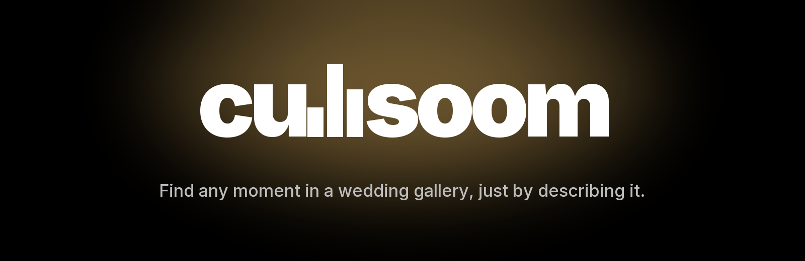
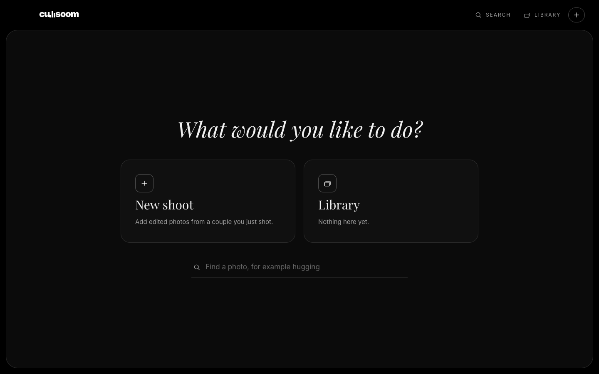
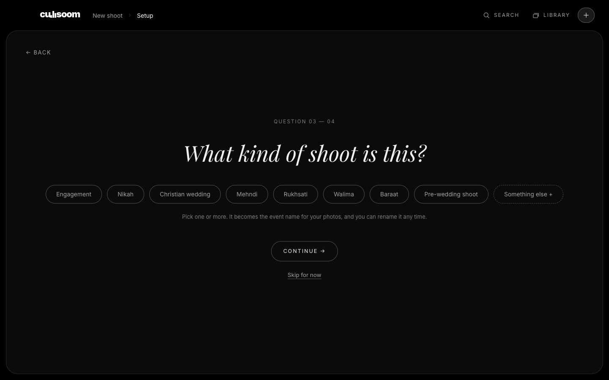
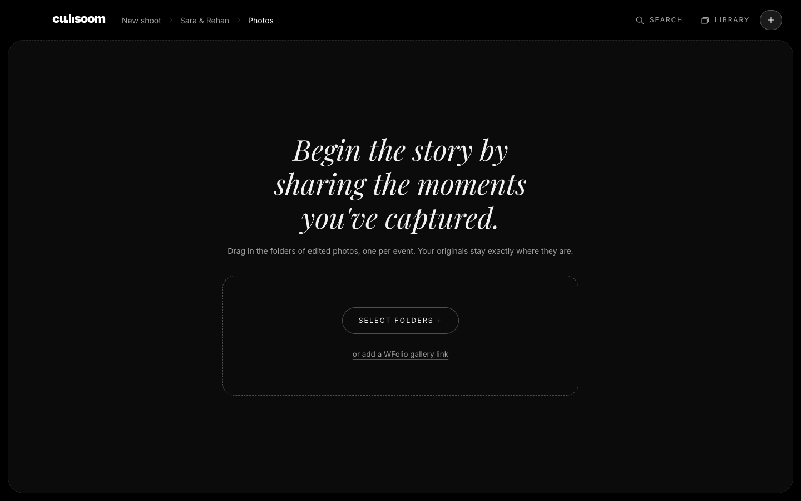
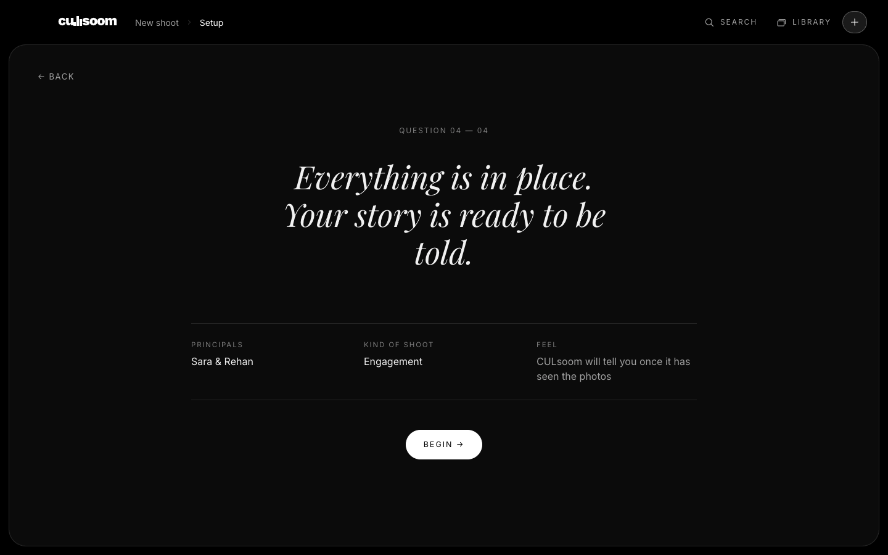

  

  

  
  
  
  

  <b><a href="#download">Download</a></b> ·
  <b><a href="#see-it">See it</a></b> ·
  <b><a href="#your-first-shoot-in-six-steps">Tutorial</a></b> ·
  <b><a href="#what-people-use-it-for">Use cases</a></b> ·
  <b><a href="#questions-people-ask">FAQ</a></b>

---

## Download

> [!IMPORTANT]
> **This page is where you download CULsoom.** Click **[Download for Mac](https://github.com/ShehzorTK/culsoom-releases/releases/latest)**, then under **Assets** choose the `.dmg` file.

> [!NOTE]
> **A proper landing page is under construction.** Until it's ready, this page is the home of CULsoom, and the link above always points to the newest version.

| | |
|---|---|
| **Version up now** | **0.1.0** (first public version), released 18 October 2026 |
| **Works on** | Macs with Apple Silicon (M1 or newer) |
| **Download size** | about 147 MB, plus about 2 GB of photo models fetched on first launch |
| **Needs the internet** | only for that first launch; after that it works offline |
| **Your photos** | stay where they are. CULsoom only reads them |

### Install in three steps

1. **Open the `.dmg`** and drag **CULsoom** into your **Applications** folder.
2. **Open CULsoom.** The first time, macOS says it can't verify the developer, because the app isn't signed with an Apple developer account yet. **Right-click the app, choose Open, then Open again.** (If you don't see an Open button: System Settings, Privacy & Security, **Open Anyway**.) You only do this once.
3. **Wait for the first-launch setup.** CULsoom downloads its photo models once (about 2 GB, a few minutes). Then it opens and never needs to again.

---

## What is CULsoom?

CULsoom is a Mac app for photographers. Point it at the edited photos from a shoot and it:

- **tags every moment**, about 190 kinds of things: places, light, style, clothing, details, actions, mood, and wedding moments like hugging, crying or rukhsati;
- **writes a description** of each photo;
- **finds the faces and groups the people**, so you tell it once who is the bride and groom and it follows them through every photo;
- **lets you search in plain words**: "bride hugging her mother and crying", "kiss on the cheek", "barefoot on the sand";
- **exports organised copies with the tags inside each JPEG** as Lightroom keywords.

Everything is done on your Mac. No photo is sent to a cloud AI, and your original files are never changed.

## See it

<table>
  <tr>
    <td width="50%"> <b>Start.</b> New shoot, your library, or search straight away.</td>
    <td width="50%"> <b>New shoot.</b> A few calm questions, one per screen.</td>
  </tr>
  <tr>
    <td width="50%"> <b>Add photos.</b> Drag in folders, or paste a WFolio gallery link. Originals stay where they are.</td>
    <td width="50%"> <b>Ready.</b> Everything in place, one button to begin.</td>
  </tr>
</table>

The screens that show a shoot (the tag list, search results, naming people, reviewing guesses, exporting) are not pictured here yet, to keep anyone's photos off this page.

### The look

CULsoom is built to stay out of your photos' way: a near-black canvas, one serif voice for questions, one bold wordmark, motion that is short and calm, and no scores or alarms. Every screen has one main thing to do.

---

## Your first shoot in six steps

1. **Start a new shoot.** Click the **+** at the top right. Type the couple's name, the date, and what kind of shoot it is (engagement, nikah, Christian wedding, mehndi, or your own words).
2. **Add the photos.** Drag in the folders of *edited JPEGs*, one folder per event, or paste a WFolio gallery link. Give each folder an event name you like. Your originals are never moved or changed.
3. **Press Start and carry on.** CULsoom previews, tags and describes the photos in the background. You can browse as soon as it has found the faces, and you can pause it at any time.
4. **Tell it who is who.** Open **People**. Each time you see a face group, press a key: bride, groom, parents, family. Your answer tags every photo that person is in. Spot a wrong or missing face later? Open a photo and click the face to fix it.
5. **Search and check.** Type what you remember, like "father and bride" or "golden light". Open **Review** to confirm or remove the tags CULsoom isn't sure about. Every answer is saved at once and can be undone.
6. **Export for Lightroom.** Open **Export**, choose a folder, and CULsoom writes organised copies, one folder per event, with the tags inside each JPEG. In Lightroom, choose Import and pick that folder.

## What people use it for

- **"Find the photo the bride's mother is asking about."** Search "bride hugging her mother and crying". No scrolling through 2,000 photos.
- **Pick the album.** Search "father and bride", "kiss on the cheek", "first look" and the likely favourites are in front of you.
- **Hand the catalogue to Lightroom.** Export once and your keywords are already in Lightroom, organised by event, people and moment.
- **Tidy a big shoot.** Browse the shoot by event, by people, or by tag instead of by file name.
- **Revisit an old shoot.** Everything stays searchable in your library; ask for "mehndi hands" a year later.

---

## Questions people ask

<b>Is my data private?</b>

Yes. The AI runs on your Mac. Your photos and the tags never leave it. The only downloads are the models on first launch and, if you use one, the previews from a WFolio gallery link.

<b>Does it change, move or delete my photos?</b>

No. CULsoom only reads your originals. It keeps its own small copies (previews, tags, face crops) in its library. Exporting writes *new copies* to a folder you choose. Removing a shoot in the app deletes only CULsoom's own copies.

<b>Why does macOS warn me when I open it?</b>

Apple charges for the developer account that lets an app skip that warning, and CULsoom isn't signed with one yet. The app is safe to open: right-click it, choose **Open**, then **Open** again. You only do this the first time.

<b>Which photos can I use? RAW?</b>

Edited **JPEGs**, from folders on your Mac or a WFolio gallery. RAW files aren't supported yet. Other files in a folder are skipped and counted.

<b>How long does a shoot take?</b>

Finding the faces and tags is quick. Writing a description of each photo is the slow part: on an M1 MacBook Air it took about **3 seconds per photo** when I tested an early version, so 1,000 photos is roughly an hour. You don't have to wait: you can name people, browse and search while it keeps working, and you can pause and resume.

<b>What is a "maybe" tag?</b>

A tag is **confirmed** when the picture and CULsoom's written description agree. When only one of them suggests it, it's shown lighter as a **maybe**. Open **Review** to confirm or remove maybes, or click any tag on a photo.

<b>It got someone wrong, or says "Someone". How do I fix it?</b>

Open the photo and click the face. Choose who it is, or "none of the people I named". Your choice is final: CULsoom never overrides it. Named people also catch small faces in wide shots that look like them.

<b>How do I get the tags into Lightroom?</b>

Use **Export**, choose **Organized copies with keywords**, and pick a folder. In Lightroom Classic choose **File, Import Photos**, and select that folder. The keywords (Event, People, Moment) arrive with the photos. You can rename those group names in the keyword preview before exporting.

<b>Does it work offline? On Windows or Intel Macs?</b>

Offline: yes, after the first launch. Windows and Intel Macs: not yet. This version is for Apple Silicon Macs (M1 or newer).

<b>Where is my library? How do I update or uninstall?</b>

Your library lives in `~/Library/Application Support/CULsoom`. **To update:** download the newest `.dmg` from this page, drag the new CULsoom over the old one in Applications; your library carries over. **To uninstall:** delete the app from Applications, and delete that folder if you also want to remove your library.

<b>Is there a website?</b>

A landing page is under construction. Until then, this page is where CULsoom lives.

---

## What's coming

Collections and Insights, Windows and Intel builds, a signed and notarised app (no warning on first open), and a proper landing page.

CULsoom 0.1.0 · made for photographers · runs on your Mac

